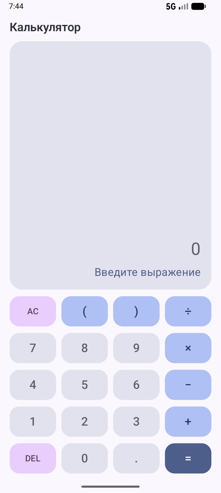
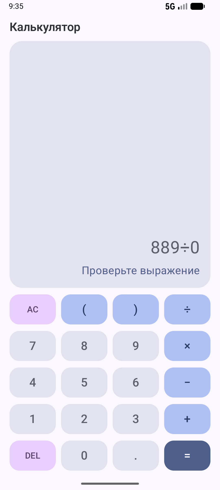
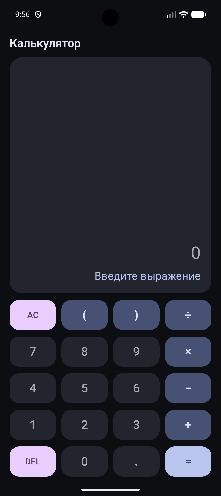

# DoMath — Android Expression Calculator

DoMath is a lightweight Android calculator built with Kotlin and Jetpack Compose. It evaluates mathematical expressions with parentheses through a custom expression parser.

## Features

- Supports addition, subtraction, multiplication, and division
- Evaluates expressions with parentheses and operator precedence
- Supports decimal numbers and negative values
- Includes Clear (`AC`), Delete (`DEL`), and Calculate (`=`) actions
- Displays an error message for invalid expressions and division by zero
- Uses a Material 3 theme and a Compose-based interface

## Tech Stack

- Kotlin
- Android Studio
- Jetpack Compose
- Material 3
- Gradle

## Screenshots

### Calculator



### Error handling



### Dark theme




## Tests

The project includes local unit tests for the expression parser. They cover:

- Expressions with parentheses
- Operator precedence
- Negative numbers
- Division by zero
- Missing closing parentheses

Run the unit tests from the project root:

```bash
./gradlew :app:testDebugUnitTest
